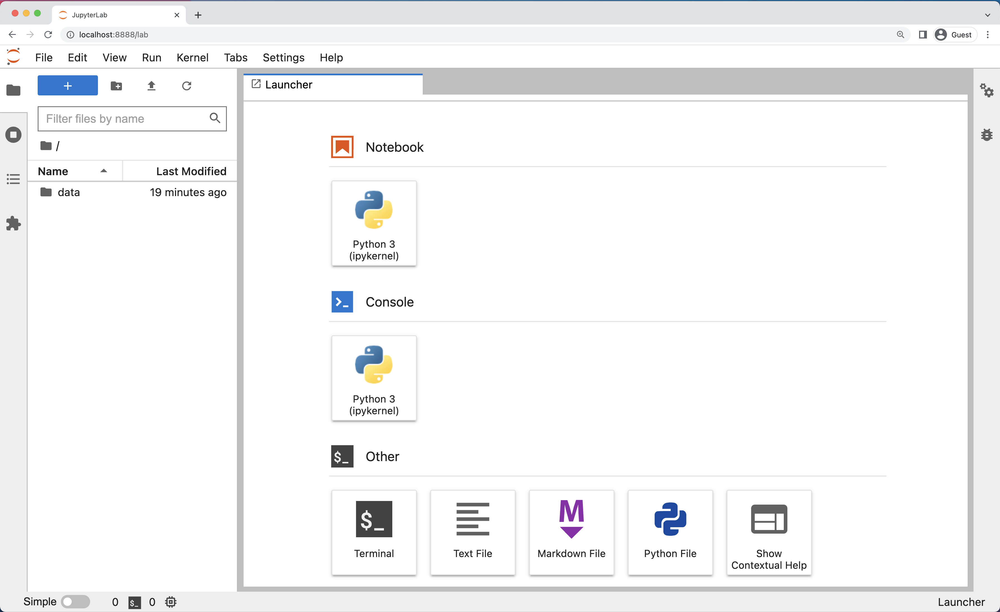
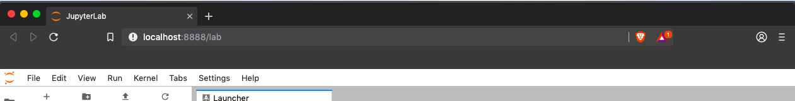
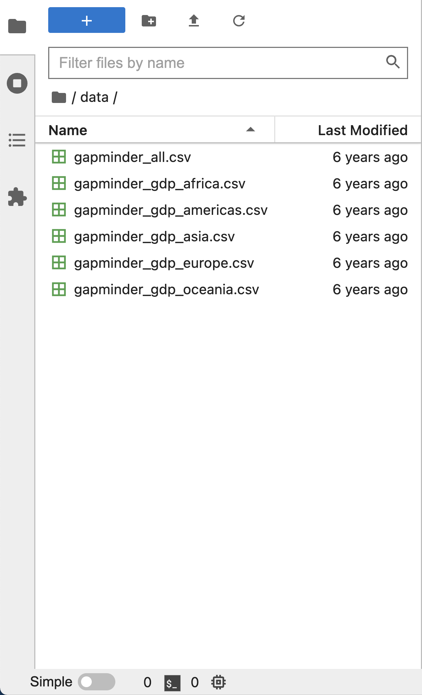
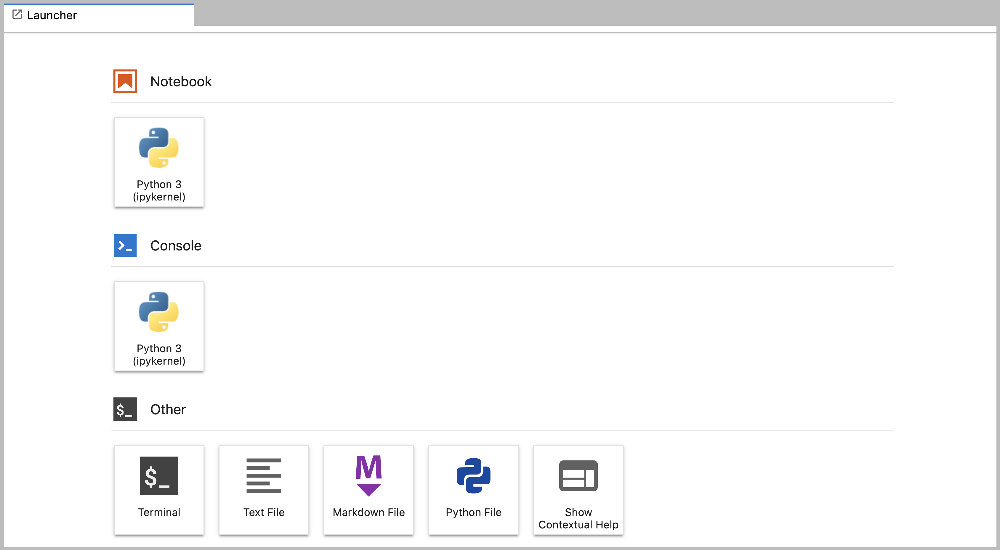
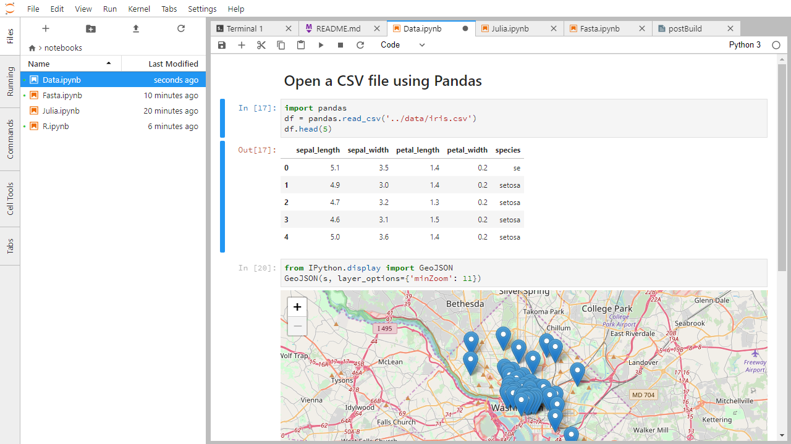
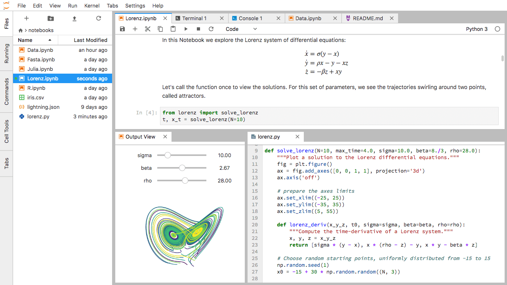

::::::::::::::::::::::::::::::::::::::: objectives

- Spustit server JupyterLab.
- Vytvořit nový skript v Pythonu.
- Vytvořit Jupyter notebook.
- Vypnout server JupyterLab.
- Vysvětlit, čím se liší skript v Pythonu od Jupyter notebooku.
- Psát v notebooku text v Markdownu.
- Psát a spouštět v notebooku kód v Pythonu.

::::::::::::::::::::::::::::::::::::::::::::::::::

:::::::::::::::::::::::::::::::::::::::: questions

- Jak se spouští program v Pythonu?

::::::::::::::::::::::::::::::::::::::::::::::::::

Python budeme v celém kurzu spouštět v [Jupyter noteboocích][jupyter] v prostředí [JupyterLab][jupyterlab]. Notebooky se hodně používají v datové vědě a při práci s grafy. Kód v nich spouštíte po kouscích, výsledek vidíte hned pod ním a celý notebook pak můžete snadno poslat dál.

Kód se samozřejmě dá psát i jinde. Programátoři často pracují ve vývojovém prostředí (IDE, _integrated development environment_), jako je [PyCharm](https://www.jetbrains.com/pycharm/) nebo [Visual Studio Code](https://code.visualstudio.com/), nebo v textových editorech typu Vim či Emacs. Program v nich napíšou, uloží a pak ho spustí buď přímo v editoru, nebo v příkazové řádce. V notebooku je to kratší cesta: napíšete kód, spustíte ho a výsledek máte hned před očima.

JupyterLab toho umí víc:

- Kód v něm pohodlně píšete, upravujete, kopírujete a vkládáte.
- Když začnete psát název a zmáčknete <kbd>Tab</kbd>, JupyterLab ho doplní (_tab completion_)
  a ukáže vám, co máte k dispozici.
- Ke kódu můžete připsat poznámky s odkazy, nadpisy nebo odrážkami, aby se v něm vyznali
  kolegové i vy sami za pár měsíců.
- Grafy a obrázky se zobrazují hned pod kódem, který je vytvořil, takže máte celou analýzu
  pohromadě.

Notebook se skládá z buněk (_cells_). V buňce může být kód, text nebo obrázek.

## Začínáme s JupyterLabem

JupyterLab je aplikace z [projektu Jupyter][jupyter], která běží jako server a ovládá se
přes webový prohlížeč. Můžete v ní mít vedle sebe notebooky, textové editory, terminály
a další nástroje. Stačí vám k tomu rozumně aktuální prohlížeč, nejlépe Chrome, Safari
nebo Firefox.

JupyterLab je součástí distribuce Anaconda. Pokud ji ještě nemáte, podívejte se do
[pokynů k instalaci](../learners/setup.md).

V lekci budeme JupyterLab spouštět na vlastním počítači, takže internet potřebujete jen
na stažení a instalaci. Funguje to takhle:

- Na počítači spustíte server JupyterLab.
- V prohlížeči se otevře adresa začínající na `localhost`, přes kterou se k serveru připojíte.
- Kód napíšete do prohlížeče, server ho spustí a prohlížeč vám ukáže výsledek.

::::::::::::::::::::::::::::::::::::::::: callout

## JupyterLab? A co Jupyter notebooky?

JupyterLab je [nástupcem klasického Jupyter Notebooku](https://jupyterlab.readthedocs.io/en/stable/getting_started/overview.html#overview).
Pokud jste už s notebooky pracovali, bude vám JupyterLab povědomý.

Kdo chce znát podrobnosti o rozdílech mezi oběma rozhraními, najde je
v [dokumentaci k rozhraní JupyterLabu][jupyterlab-ui] (anglicky).

::::::::::::::::::::::::::::::::::::::::::::::::::

## Spuštění JupyterLabu {#spusteni-jupyterlabu}

JupyterLab spustíte z příkazové řádky. Na Macu k tomu poslouží Terminál, ve Windows
Anaconda Prompt.

### macOS

Terminál otevřete jedním ze dvou způsobů:

1. Ve složce Aplikace (_Applications_) otevřete Utility (_Utilities_) a dvakrát klikněte na Terminál.
2. Stiskněte <kbd>Command</kbd> + <kbd>mezerník</kbd>, napište `Terminal` a potvrďte
   klávesou <kbd>Enter</kbd>.

V Terminálu pak napište:

```bash
jupyter lab
```

### Windows

Stiskněte <kbd>klávesu s logem Windows</kbd>, vyhledejte `Anaconda Prompt` a spusťte ho.
Potom napište:

```bash
jupyter lab
```

Za chvíli se ve vašem výchozím prohlížeči otevře úvodní stránka JupyterLabu. Bude vypadat
podobně jako tahle:

<p align='center'>
  
</p>

## Rozhraní JupyterLabu

JupyterLab umí spoustu věcí jako běžná vývojová prostředí (IDE), ale je stavěný hlavně
na interaktivní práci, při které s kódem a daty zkoušíte, co funguje.

[Rozhraní JupyterLabu][jupyterlab-ui] má tři hlavní části: nahoře _Menu Bar_ (panel nabídek),
vlevo sklopitelný _Left Side Bar_ (levý postranní panel) a uprostřed _Main Work Area_
(hlavní pracovní plocha) s kartami otevřených dokumentů a nástrojů.

Názvy nabídek a tlačítek necháváme v angličtině, protože přesně tak je v JupyterLabu uvidíte.

### Menu Bar (panel nabídek)

V horní liště jsou hlavní nabídky. U většiny akcí najdete i klávesovou zkratku.
Ve výchozím nastavení tu jsou tyto nabídky:

- **File** (soubor): práce se soubory a složkami – _New_, _Open_, _Close_, _Save_ a další. Je tu i _Shut Down_, kterým JupyterLab vypnete.
- **Edit** (úpravy): _Undo_, _Cut_, _Copy_, _Paste_ a další úpravy.
- **View** (zobrazení): mění vzhled JupyterLabu.
- **Run** (spuštění): spouštění kódu v noteboocích a konzolích.
- **Kernel** (jádro): správa kernelů. Co kernel je, vysvětlujeme o kousek níž.
- **Tabs** (karty): seznam otevřených dokumentů a nástrojů.
- **Settings** (nastavení): běžná nastavení JupyterLabu. Kdo chce víc, najde tu i _Advanced Settings Editor_.
- **Help** (nápověda): odkazy na nápovědu k JupyterLabu a ke kernelům.

::::::::::::::::::::::::::::::::::::::::: callout

## Kernel (jádro)

[Dokumentace JupyterLabu](https://jupyterlab.readthedocs.io/en/stable/user/documents_kernels.html)
popisuje kernely jako „samostatné procesy spuštěné serverem, které spouštějí váš kód v různých programovacích jazycích a prostředích“.
Jakmile otevřete notebook, spustí se kernel, tedy proces, který bude váš kód provádět.
My budeme používat kernel ipython, který spouští Python 3.

Existují i [kernely pro jiné jazyky](https://github.com/jupyter/jupyter/wiki/Jupyter-kernels),
takže ve stejném JupyterLabu můžete psát třeba v R, Javě, Julii, Ruby, JavaScriptu nebo Fortranu.

::::::::::::::::::::::::::::::::::::::::::::::::::

Takhle vypadá výchozí _Menu Bar_:

<p align='center'>   
</p>

### Left Sidebar (levý postranní panel)

V levém postranním panelu najdete několik často používaných karet: prohlížeč souborů
(ukazuje obsah složky, ve které jste JupyterLab spustili), seznam běžících kernelů
a terminálů, paletu příkazů (_command palette_) a seznam otevřených karet.

<p align='center'>   
</p>

Panel schováte a zase zobrazíte v nabídce _View_ volbou „Show Left Sidebar“, nebo kliknutím
na kartu, která je v panelu právě otevřená.

### Main Work Area (hlavní pracovní plocha)

Na hlavní pracovní ploše si můžete dokumenty (notebooky, textové soubory…) a nástroje
(terminály, konzole…) rozložit do panelů s kartami. Panely jde zvětšovat, zmenšovat
i dál dělit.

Pokud nevidíte kartu _Launcher_ (spouštěč), klikněte na modré tlačítko + pod nabídkami _File_ a _Edit_.

<p align='center'>   
</p>

Kartu do jiného panelu přesunete tak, že ji přetáhnete doprostřed toho panelu. Když ji
přetáhnete k jeho okraji (vlevo, vpravo, nahoru nebo dolů), panel se rozdělí. Karta,
se kterou právě pracujete, má nahoře barevný proužek (obvykle modrý).

## Vytvoření skriptu v Pythonu

- Na kartě _Launcher_ klikněte v části _Other_ na ikonu _Text File_.
  - Nový textový soubor vytvoříte i přes _File -> New -> Text File_.
- Aby z něj byl program v Pythonu, uložte ho přes _File -> Save File As_ pod názvem, který končí na `.py`.
  - Přípona `.py` dává všem (i operačnímu systému) najevo, že jde o program v Pythonu.
  - Je to zvyklost, ne povinnost.

## Vytvoření Jupyter notebooku

Nový notebook otevřete na kartě _Launcher_ kliknutím na ikonu Python 3 v části _Notebook_,
nebo přes _File -> New -> Notebook_.

Pár dalších poznámek:

- Notebooky mají příponu `.ipynb`, aby se nepletly s obyčejnými programy v Pythonu.
- Notebook můžete vyexportovat jako skript v Pythonu a ten pak spouštět z příkazové řádky.

Takhle vypadá notebook otevřený v JupyterLabu. Podrobnosti najdete
v [oficiální dokumentaci k notebookům][jupyterlab-notebook-docs] (anglicky).

<p align='center'>   
</p>

::::::::::::::::::::::::::::::::::::::::: callout

## Jak se notebook ukládá

- Notebook se ukládá ve formátu JSON.
- Stejně jako u webové stránky vypadá uložený soubor jinak než to, co vidíte v prohlížeči.
- Právě díky tomu ale může Jupyter v jednom souboru držet kód, text i obrázky.

::::::::::::::::::::::::::::::::::::::::::::::::::

::::::::::::::::::::::::::::::::::::::: challenge

## Rozložení dokumentů do panelů

Na hlavní pracovní ploše si můžete dokumenty rozložit do panelů s kartami. Tady je
příklad z [oficiální dokumentace][jupyterlab]:

<p align='center'>   
</p>

Nejdřív otevřete textový soubor, konzoli Pythonu (_Python console_) a terminál a rozložte
je do tří panelů. Pak totéž zkuste s notebookem, terminálem a textovým souborem. Nakonec
si poskládejte vlastní rozložení. Jaké by se vám při práci hodilo nejvíc?

::::::::::::::: solution

## Řešení

Když máte karty otevřené, přetáhněte jednu z nich doprostřed jiného panelu – tím ji do něj
přesunete. Panel rozdělíte tak, že kartu přetáhnete k jeho okraji.

:::::::::::::::::::::::::

::::::::::::::::::::::::::::::::::::::::::::::::::

::::::::::::::::::::::::::::::::::::::::: callout

## Kód vs. text

Jupyter míchá kód a text v různých blocích, kterým se říká buňky (_cells_). „Kódem“ obvykle
myslíme zdrojový kód programu napsaný v jazyce, jako je Python. Buňka s kódem (_code cell_)
tedy obsahuje program a textová buňka (_text cell_) obyčejný text pro lidi.

::::::::::::::::::::::::::::::::::::::::::::::::::

## Notebook má dva režimy: Command a Edit

- Zkuste střídavě mačkat <kbd>Esc</kbd> a <kbd>Enter</kbd>. Okraj buňky se bude měnit ze šedé na modrou a zpátky.
- To jsou dva režimy notebooku: **Command mode** (příkazový režim, šedý okraj) a **Edit mode** (režim úprav, modrý okraj).
- V režimu Command pracujete s buňkami jako s celky, v režimu Edit píšete dovnitř buňky.
- V režimu Command (<kbd>Esc</kbd>, šedý okraj) fungují tyto klávesy:
  - <kbd>b</kbd> přidá novou buňku pod aktuální buňku,
  - <kbd>a</kbd> přidá novou buňku nad ni,
  - <kbd>x</kbd> aktuální buňku smaže,
  - <kbd>z</kbd> vrátí poslední operaci s buňkou (smazání, přidání a podobně).
- Všechno najdete i v nabídkách, ale se zkratkami budete mnohem rychlejší.

::::::::::::::::::::::::::::::::::::::: challenge

## Command vs. Edit

V jakém režimu je teď váš notebook – Command, nebo Edit?
Přepněte se do druhého režimu a zase zpátky.
Zkratkou přidejte novou buňku.
Zkratkou ji smažte.
Zkratkou vraťte poslední operaci s buňkou.

::::::::::::::: solution

## Řešení

Režim Command má šedý okraj, režim Edit modrý. Mezi nimi přepínáte klávesami
<kbd>Esc</kbd> a <kbd>Enter</kbd>.

Všechny tři zkratky fungují jen v režimu Command (pokud je okraj modrý, stiskněte nejdřív
<kbd>Esc</kbd>):

- novou buňku přidáte klávesou <kbd>b</kbd> nebo <kbd>a</kbd>,
- smažete ji klávesou <kbd>x</kbd>,
- poslední operaci vrátíte klávesou <kbd>z</kbd>.

:::::::::::::::::::::::::

::::::::::::::::::::::::::::::::::::::::::::::::::

### Buňky vybírejte a upravujte klávesnicí a myší

- Klávesou <kbd>Enter</kbd> se přepnete do režimu Edit (okraj zmodrá) a můžete do buňky psát.
- Do jedné buňky často píšeme víc řádků kódu, proto <kbd>Enter</kbd> v režimu Edit jen
  odřádkuje, stejně jako v textovém editoru.
- Buňku spustíte zkratkou <kbd>Shift</kbd>\+<kbd>Enter</kbd>.
- Na pravé straně klávesnice jsou <kbd>Enter</kbd> a <kbd>Shift</kbd> hned vedle sebe,
  takže to zvládnete jednou rukou.

### Notebook převede Markdown na pěkně formátovaný text

- Notebook umí zobrazit i [Markdown][markdown].
  - Markdown je jednoduchý textový formát, ve kterém píšete seznamy, odkazy a další věci,
    které znáte z webových stránek.
  - Dá se brát i jako zjednodušené HTML, které vypadá jako text ze staromódního e-mailu.
- Buňku změníte na buňku s Markdownem (_Markdown cell_) tak, že v režimu Command
  (<kbd>Esc</kbd>, šedý okraj) zmáčknete klávesu <kbd>M</kbd>.
- Zmizí `In [ ]:` – podle toho poznáte, že už to není buňka s kódem – a můžete psát
  v Markdownu.
- Zpátky na buňku s kódem (_Code cell_) ji přepnete v režimu Command klávesou <kbd>y</kbd>.

### Markdown umí většinu toho, co HTML

<!-- prettier-ignore-start -->
<!-- Tabulka je ve formátu „grid table“ (pandoc). Prettier by jí zrušil zarovnání. -->

Table: Ukázky Markdownu a toho, jak se zobrazí.

+--------------------------------------------------------+----------------------------------------------------+
| Napíšete                                               | Uvidíte                                            |
+========================================================+====================================================+
| ~~~                                                    | <p></p>                                            |
| -   Pomlčkami                                          | -   Pomlčkami                                      |
| -   uděláte                                            | -   uděláte                                        |
| -   odrážkový seznam.                                  | -   odrážkový seznam.                              |
| ~~~                                                    |                                                    |
+--------------------------------------------------------+----------------------------------------------------+
| ~~~                                                    | <p></p>                                            |
| 1.   Čísly                                             | 1.   Čísly                                         |
| 1.   uděláte                                           | 2.   uděláte                                       |
| 1.   číslovaný seznam.                                 | 3.   číslovaný seznam.                             |
| ~~~                                                    |                                                    |
+--------------------------------------------------------+----------------------------------------------------+
| ~~~                                                    | <p></p>                                            |
| -  Odsazením                                           | - Odsazením                                        |
|    -  uděláte vnořený seznam                           |   - uděláte vnořený seznam                         |
|    -  stejného typu                                    |   - stejného typu                                  |
| -  nebo vnořený seznam                                 | - nebo vnořený seznam                              |
|    1. jiného                                           |   1. jiného                                        |
|    1. typu                                             |   2. typu                                          |
| ~~~                                                    |                                                    |
+--------------------------------------------------------+----------------------------------------------------+
| ~~~                                                    | <p></p>                                            |
| # Nadpis 1. úrovně                                     | ## Nadpis 1. úrovně                                |
| ~~~                                                    |                                                    |
+--------------------------------------------------------+----------------------------------------------------+
| ~~~                                                    | <p></p>                                            |
| ## Nadpis 2. úrovně (atd.)                             | ### Nadpis 2. úrovně (atd.)                        |
| ~~~                                                    |                                                    |
+--------------------------------------------------------+----------------------------------------------------+
| ~~~                                                    | <p></p>                                            |
| Na zalomení řádků                                      | Na zalomení řádků                                  |
| nezáleží.                                              | nezáleží.                                          |
|                                                        |                                                    |
| Prázdný řádek ale                                      | Prázdný řádek ale                                  |
| začne nový odstavec.                                   | začne nový odstavec.                               |
| ~~~                                                    |                                                    |
+--------------------------------------------------------+----------------------------------------------------+
| ~~~                                                    | <p></p>                                            |
| [Odkazy](https://www.python.org)                       | [Odkazy](https://www.python.org)                   |
| se píšou jako `[...](...)`.                            | se píšou jako `[...](...)`.                        |
| Nebo použijte [pojmenované odkazy][jupyter_web].       | Nebo použijte [pojmenované odkazy][jupyter_web].   |
|                                                        |                                                    |
| [jupyter_web]: <https://jupyter.org>                   |                                                    |
| ~~~                                                    |                                                    |
+--------------------------------------------------------+----------------------------------------------------+

<!-- prettier-ignore-end -->

::::::::::::::::::::::::::::::::::::::: challenge

## Seznamy v Markdownu

V buňce s Markdownem vytvořte tenhle vnořený seznam:

1. Sehnat peníze.
2. Udělat práci.
   - Navrhnout experiment.
   - Nasbírat data.
   - Vyhodnotit je.
3. Sepsat výsledky.
4. Publikovat.

::::::::::::::: solution

## Řešení

Cvičení kombinuje číslovaný seznam s odrážkovým. Odrážky musí být odsazené tak, aby
začínaly ve stejném sloupci jako text číslovaných položek – tady o 4 mezery.

```markdown
1.  Sehnat peníze.
2.  Udělat práci.
    - Navrhnout experiment.
    - Nasbírat data.
    - Vyhodnotit je.
3.  Sepsat výsledky.
4.  Publikovat.
```

:::::::::::::::::::::::::

::::::::::::::::::::::::::::::::::::::::::::::::::

::::::::::::::::::::::::::::::::::::::: challenge

## Více výpočtů

Co se zobrazí, když v notebooku spustíte buňku s několika výpočty?
Zkuste třeba tuhle:

```python
7 * 3
2 + 1
```

::::::::::::::: solution

## Řešení

Python ukáže jen výsledek posledního výpočtu.

```python
3
```

:::::::::::::::::::::::::

::::::::::::::::::::::::::::::::::::::::::::::::::

::::::::::::::::::::::::::::::::::::::: challenge

## Z kódu na Markdown

Co se stane, když do buňky s kódem napíšete kód v Pythonu a pak buňku přepnete na Markdown?
Napište do buňky s kódem třeba tohle:

```python
x = 6 * 7 + 12
print(x)
```

Spusťte ji (<kbd>Shift</kbd>\+<kbd>Enter</kbd>) a ověřte si, že funguje. Pak se do ní vraťte,
zmáčkněte <kbd>Esc</kbd> a potom <kbd>m</kbd>, tím ji přepnete na Markdown, a znovu ji
„spusťte“ přes <kbd>Shift</kbd>\+<kbd>Enter</kbd>.
Co se stalo? K čemu by se to mohlo hodit?

::::::::::::::: solution

## Řešení

Kód se teď zobrazí jako obyčejný text v Markdownu a řádky se spojí do jednoho odstavce.
Hodí se to, když chcete nějakou buňku dočasně „vypnout“, třeba v notebooku, který
používáte k víc věcem.

```python
x = 6 * 7 + 12 print(x)
```

:::::::::::::::::::::::::

::::::::::::::::::::::::::::::::::::::::::::::::::

::::::::::::::::::::::::::::::::::::::: challenge

## Rovnice

Běžný Markdown (třeba ten, ve kterém jsou napsané tyhle materiály) rovnice nezobrazí,
notebook ale ano. Vytvořte novou buňku s Markdownem a napište do ní:

```latex
$\sum_{i=1}^{N} 2^{-i} \approx 1$
```

(Asi bude jednodušší text zkopírovat.)
Co se zobrazí? Co podle vás dělá podtržítko `_`, stříška `^` a dolar `$`?

::::::::::::::: solution

## Řešení

Notebook rovnici vysází podobně jako LaTeX.
Dolary `$` říkají Markdownu, že text mezi nimi je rovnice v LaTeXu.
Pokud LaTeX neznáte: podtržítko `_` dělá dolní index a stříška `^` horní index.
Složené závorky `{` a `}` seskupují text, takže dolním indexem je celé `i=1` a horním `N`.
Ze stejného důvodu je ve složených závorkách i `-i`, aby se celé stalo horním indexem čísla `2`.
`\sum` a `\approx` jsou příkazy LaTeXu pro symboly „součet“ a „přibližně rovno“.

:::::::::::::::::::::::::

::::::::::::::::::::::::::::::::::::::::::::::::::

## Vypnutí JupyterLabu

- V nabídce _File_ zvolte úplně dole _Shut Down_. JupyterLab se zeptá, jestli ho opravdu chcete vypnout (nezapomeňte si předtím uložit práci!). Potvrďte to tlačítkem _Shut Down_.
- Když ho budete chtít spustit znovu, napište do příkazové řádky opět:

```bash
jupyter lab
```

::::::::::::::::::::::::::::::::::::::: challenge

## Vypnutí JupyterLabu

Vyzkoušejte si JupyterLab vypnout a znovu zapnout.

::::::::::::::::::::::::::::::::::::::::::::::::::

[jupyter]: https://jupyter.org/
[jupyterlab]: https://jupyterlab.readthedocs.io/en/stable/
[jupyterlab-ui]: https://jupyterlab.readthedocs.io/en/stable/user/interface.html
[jupyterlab-notebook-docs]: https://jupyterlab.readthedocs.io/en/stable/user/notebook.html
[markdown]: https://cs.wikipedia.org/wiki/Markdown
[jupyter_web]: https://jupyter.org

:::::::::::::::::::::::::::::::::::::::: keypoints

- Skripty v Pythonu jsou obyčejné textové soubory.
- Kód v Pythonu budeme psát a spouštět v Jupyter notebooku.
- Notebook má dva režimy: Command a Edit.
- Buňky vybíráte a upravujete klávesnicí i myší.
- Notebook převede Markdown na pěkně formátovaný text.
- Markdown umí většinu toho, co HTML.

::::::::::::::::::::::::::::::::::::::::::::::::::
